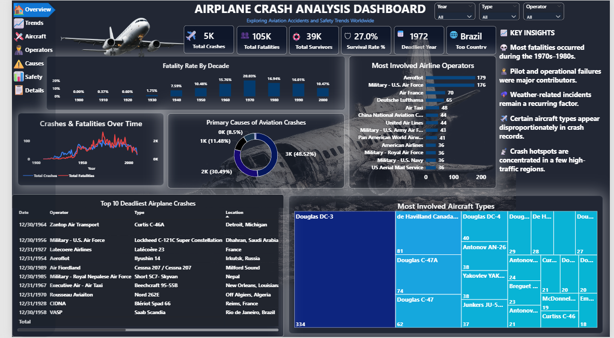

# Airplane Crash Analysis Dashboard

## Project Overview
This Power BI dashboard explores aviation accidents and safety trends worldwide. It provides a comprehensive view of historical crash data, analyzing fatalities, survival rates, and root causes over time.

## Key Metrics
* Total Crashes: 5K
* Total Fatalities: 105K
* Total Survivors: 39K
* Survival Rate: 27.0%
* Deadliest Year: 1972
* Top Country for Incidents: Brazil

## Key Insights
* Most fatalities occurred during the 1970s–1980s.
* Pilot and operational failures were major contributors to accidents.
* Weather-related incidents remain a recurring factor.
* Certain aircraft types (like the Douglas DC-3) appear disproportionately in crash records.
* Crash hotspots are concentrated in a few high-traffic regions.

## Dashboard Visualizations
* KPI Ribbons: High-level summary of total crashes, fatalities, and survival rates.
* Bar Charts: Fatality rates by decade and most involved airline operators (e.g., Aeroflot, Military - U.S. Air Force).
* Line Graph: Crashes and fatalities over time spanning from 1900 to 2000.
* Donut Chart: Primary causes of aviation crashes.
* Treemap: Most involved aircraft types.
* Table: Top 10 deadliest airplane crashes, detailing operator, type, and location.

## Tech Stack
* **Tool:** Power BI
* Author:
  Vansham Teotia
## How to View

1. Download the `Airplane_Crash_Analysis` file from the `dashboard` folder.
2. Open the file using Power BI Desktop.

### 📸 Dashboard Preview

